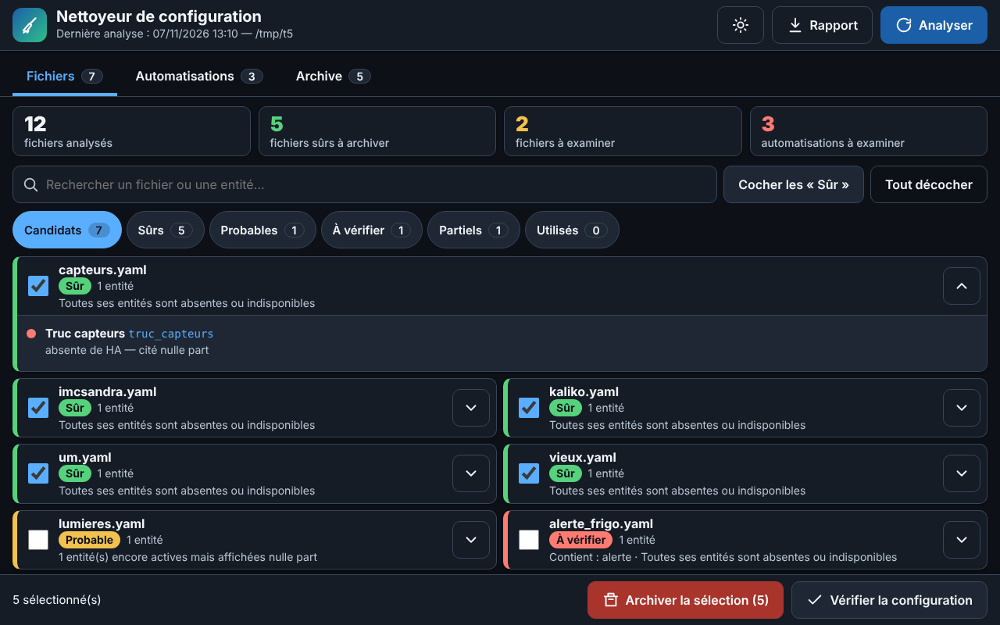
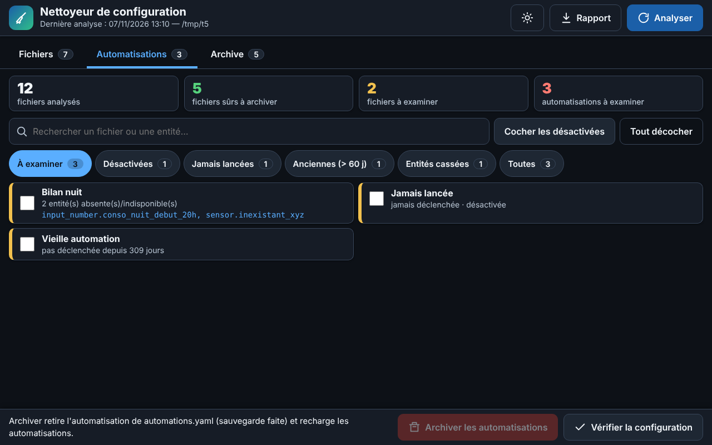

# Nettoyeur de configuration — module complémentaire Home Assistant

  

Repère les **fichiers `packages/*.yaml` et les automatisations qui ne servent plus**, explique pourquoi,
et les **archive de façon réversible** depuis une page du menu latéral de Home Assistant.

## Fonctions

- **Verdict par fichier** : *Sûr* (entités mortes et citées nulle part), *Probable* (entités vivantes mais affichées nulle part), *À vérifier* (contient une alerte, une automatisation, un script, une exposition Alexa… ou son nom est cité).
- **Analyse poussée** : YAML, tableaux de bord, tableau de bord Énergie, entités exposées, pages HTML de `www`, état réel des entités via l'API, fichiers cités seulement par d'autres fichiers inutiles.
- **Automatisations** : jamais déclenchées, anciennes, désactivées, entités absentes ou indisponibles — archivables d'un clic.
- **Réversible** : rien n'est supprimé. Fichiers déplacés dans `/config/_archive/`, automatisations déplacées dans `_archive/automations_archivees.yaml`, avec sauvegarde complète de `automations.yaml` avant chaque changement.
- **Confort** : recherche, filtres, synthèse chiffrée, confirmation avant archivage, export du rapport (Markdown), thème sombre/clair, gros texte et boutons (accessibilité).

## Installation

1. Home Assistant → **Paramètres → Modules complémentaires → Boutique → ⋮ → Dépôts**
2. Ajouter : `https://github.com/VOTRE_COMPTE/ha-unused-scan`
3. Installer **Nettoyeur de configuration**, démarrer, puis activer « Afficher dans la barre latérale ».

### Installation locale (test)
Copier le dossier `ha_unused_scan/` dans le partage Samba `addons`, puis Boutique → ⋮ → *Rechercher les mises à jour*.

## Utilisation conseillée

1. Faire une sauvegarde complète de Home Assistant.
2. Ouvrir **Nettoyeur**, cliquer sur **Analyser**.
3. Archiver par **petits lots**, en commençant par les « Sûr ».
4. **Vérifier la configuration**, redémarrer Home Assistant, contrôler *Réparations* et les tableaux de bord.
5. Attendre un jour avant le lot suivant. Un fichier archivé par erreur se restaure depuis l'onglet **Archive**.

## Sécurité

- Accessible uniquement via Home Assistant (Ingress), réservé aux administrateurs.
- Écrit uniquement dans `/config/packages/`, `/config/automations.yaml` et `/config/_archive/`.
- Aucun accès réseau externe.

## Limites

Un usage dynamique (nom d'entité construit dans un modèle) ou externe à Home Assistant n'est pas détectable.
Les résultats sont des **candidats**, pas des certitudes.

## Licence

MIT
